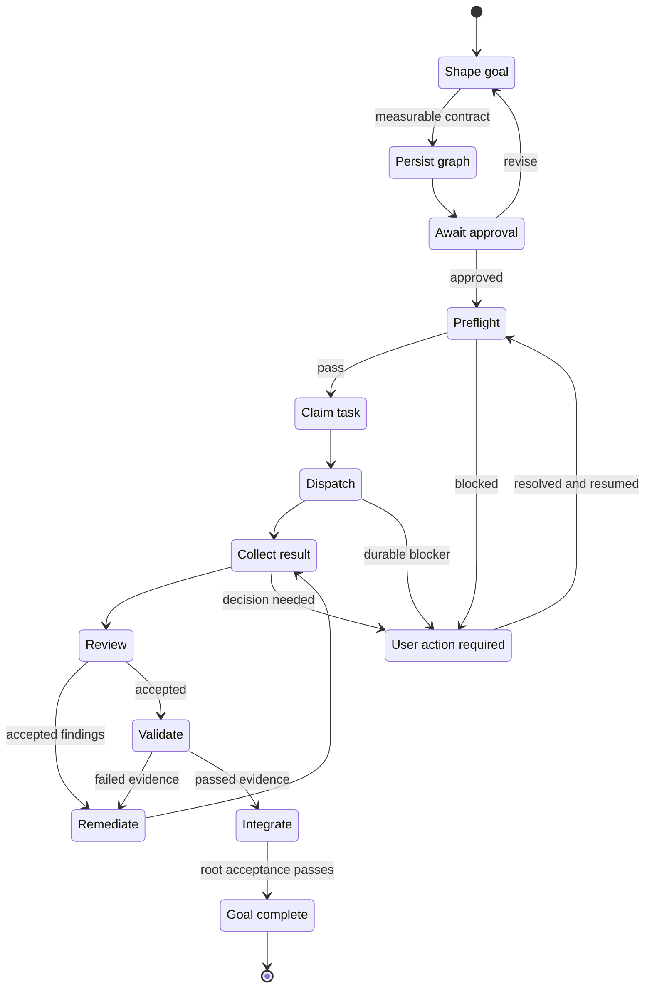

# Workflow guide

Agentflow separates durable project state from disposable agent sessions.
Beads records goals, tasks, dependencies, claims, decisions, and acceptance
evidence. Git and GitHub remain authoritative for source history, issues, pull
requests, reviews, and merges.

## Lifecycle at a glance

The approved root controller advances the graph until the goal is complete or
a durable decision is required. Provider panes and individual tasks are
intermediate state, not completion signals.

One controller chat should own one approved root. The default controller is
controller-only: it shapes, routes, dispositions, and integrates while bounded
workers perform product-file edits. Related review and remediation
remain children of that root; a materially different goal starts a new root in a
fresh chat. Agentflow records a task-aware session budget and can produce a
minimal `controller rotate` packet so another chat resumes from Beads and
controller state rather than replaying a transcript. A required rotation waits
until the current worker result is safely dispositioned, then stops before the
next wave. Repeating the same named failed approach twice also creates a durable
decision halt.

The provider chat may have started from another open project or a global skill.
Once the controller lease is acquired, Agentflow binds that provider session to
the approved workflow workspace. Subsequent hooks resolve Beads and optional
memory from the binding rather than the editor's incidental current directory.



`USER_ACTION_REQUIRED` preserves the root, claims, results, and evidence. Resume
the existing root after resolving the recorded cause; do not create a duplicate
graph or treat a disconnected chat as a new workflow.

## Separate-terminal supervision

For work that should keep advancing after the initiating chat closes, run one
supervisor in a separate terminal:

```sh
agentflow controller supervise --root . --workflow-root <root-id>
```

The command validates the exact Beads root before creating lease state, then
holds a per-root OS lock in the protected user state directory and heartbeats
the controller lease while it polls Beads and Herdr. Idle polls make no
provider/model calls; a provider is launched only when a ready task passes the
normal preflight. The first run creates the protected external credential used
for an explicit process restart. If the supervisor exits or crashes, rerun the
same command: after acquiring the lock and verifying the credential, it
continues the existing lease without rotating its fencing token or relaunching
durably recorded live tasks. Reusing the same epoch is safe because every
current `start`, `resume`, and `supervise` runner takes that lock before lease
authentication; only one can own the root at a time. Stop any runner from an
older Agentflow release that predates this lock before starting supervision. A
concurrent `start`, `resume`, or `supervise` for that root is refused while the
lock is held. There is no automatic takeover; if the protected credential is
missing or invalid, stop and recover it rather than replacing the lease.

The supervisor stops at `GOAL_COMPLETE`, `TASK_BLOCKED`,
`USER_ACTION_REQUIRED`, or `ROTATION_REQUIRED`. A loop deadline writes a
resumable `incomplete` checkpoint with `DEADLINE_EXCEEDED` and exits with code
3; it does not discard live task state. `--deadline 0` is an immediate deadline.
After resolving the cause or extending the budget, explicitly rerun
`controller supervise` to continue from the checkpoint.

## Default lifecycle

1. Define an observable goal and approve its exit conditions.
2. For substantial or environment-dependent work, map each acceptance
   condition to authoritative evidence.
3. Create bounded Beads tasks with explicit dependencies and ownership.
4. Select a native worker or an observable external session.
5. Preflight the exact base, tools, skills, output boundary, budget, retries,
   and delegation depth.
6. Claim work before mutation and keep concurrent writers in disjoint scopes.
7. Return structured outcome and evidence, not a transcript dump.
8. Review changes independently and route accepted corrections to their owner.
9. Integrate ready work in priority/FIFO order and validate the original goal.

The root execution policy derives its launch budget from graph size and bounds
parallel workers, delegation depth, per-task attempts, and expensive execution
children. Luna and Sonnet are the normal coding/exploration routes. Sol and Opus
remain controller/judgment/review routes. Terra is available only through an
explicitly selected exact route with a persisted rationale.

At execution approval, freeze the approved graph with `agentflow budget freeze
--workflow-root <root>`. The frozen baseline records the original launchable
task count and cap. Graph growth, retries, correction tasks, fallback, and
context rotation never reset it.

When cumulative launches reach the current cap, dispatch blocks until
`agentflow budget status` has been reviewed and an approved increase is appended
with `agentflow budget revise --new-cap <n> --decision-ref <ref> --reason
<text>`. Each revision keeps the earlier caps and the consumption observed at
the time.

`budget status` reports cumulative launches, active concurrency, open tasks, the
remaining serial path, and external waits separately. It gives no delivery ETA.
Launches are counted from this root's managed launch records; native subagent
sessions are not counted.

A launch that declares `metadata.agentflow.launch.approach` follows a stop rule.
After two recorded failures of that approach (`agentflow budget approach
--outcome failure`), every further launch using it is blocked, including on a
replacement task, until an owner decision is recorded with `--outcome decision`.
Roots without a frozen baseline keep the graph-derived budget.

## Execution lanes

Use native subagents for bounded, fire-and-forget work. Use Herdr for
controller-managed, long-running, cross-provider, worktree-owned, or
decision-prone sessions where observation or direct intervention is useful.
`tmux` is available for manually managed terminal handoffs only, not controller
dispatch. A live pane is an attention signal, never proof of correctness or
completion.

Generated native handoffs are direct-session contracts: they return in the
provider session and never claim that controller-owned result files exist.
Generated external handoffs are controller contracts and always require the
leased controller's authenticated return channel.

External launches consume provider allowance and therefore remain explicit
unless an approved controller is operating within its recorded budget.
Native Codex workers use a dedicated Luna profile with no inherited controller
conversation (`fork_turns="none"`) or the smallest context slice that contains
the task contract.

For an owner-approved native return, `agentflow native approve` records the
provider, base, approval reference, and acceptance IDs on the distinct task.
`agentflow native observe` records an exact-session query bound to the current
claim generation; `agentflow native accept` validates the worker's result
against the approved acceptance matrix before recording a receipt and closing
as the claim holder. `agentflow controller status` reports native visibility
separately for `in_progress` tasks:

- `confirmed_native`: an exact-session query recently observed the session;
- `stale`: a present-session observation is older than 300 seconds;
- `absent`: an exact-session query reported the session absent;
- `unobservable`: evidence is missing, malformed, unavailable, or bound to a
  different claim generation. A missing Herdr record alone is not proof of
  absence.

The native lane refuses tasks requiring trusted-model-identity,
protected-recovery, state-migration, managed-causal-proof, credential-use, or
publication. These commands do not authenticate managed results, resume old
work, or grant publication authority.

External workers always return through the controller-minted authenticated
channel. Do not launch their generated handoffs with `agentflow handoff launch`;
resume the root controller. When outbound context must be restricted, persist
`sterile: true` in `metadata.agentflow.launch`. The controller packages only
declared context, acceptance data, and self-contained pinned skills, verifies
the package inventory, and asks Herdr to use that package as the worker cwd.
The current sterile lane is read-only and rejects `shell-write`; this is
context minimization, not an OS sandbox.

## Durable Beads coordination

Initialize Beads deliberately:

```sh
agentflow init . --beads
agentflow beads status .
```

Use one approved root for an Agentflow queue. Each task needs an observable
result, exact scope, dependencies, acceptance evidence, checks, constraints,
and a halt condition. Claims are actor-bound and time-bounded. A task being
ready or assigned does not prove that a worker session is live.

Gitless projects can use Beads and Agentflow runtime state without inventing
branches, commits, pull requests, or merge gates. Serialize overlapping file
writes in that mode. External handoffs use a typed workspace contract: Git
roots pin an exact `branch@SHA`, while non-Git directories carry no Git base
and bind to their canonical absolute directory path. Preflight fails closed if
the selected workspace type or exact root differs from the handoff.

Compare Beads claims and dispositions with Herdr sessions whenever status is
unclear:

```sh
agentflow herdr reconcile --root . --workflow-root <root-id>
```

The report distinguishes claims without sessions, active sessions for terminal
Beads, results awaiting disposition, and sessions outside the requested root.
It does not treat a closed Bead or pane exit alone as authenticated completion.

## Skill routing

Keep domain skills with the project or register them through Agentflow's skill
configuration. Name required skills in every delegated assignment. Preflight
from the worker's actual checkout and stop if a required entrypoint or content
digest cannot be verified. See [SKILLS.md](SKILLS.md).

## Handoff contract

A useful assignment states:

```text
objective: one observable result
scope: owned files or read-only question
base: branch and exact revision
dependencies: task identifiers or none
acceptance: testable conditions
verify: exact commands or evidence sources
constraints: permissions and do-not rules
budget: time/cost cap, retry cap, and stop condition
return: outcome, revision, checks, risks, and references
```

If blocked, the worker stops and returns one decision or dependency, what was
tried, available options, a recommendation, and preserved state.

Preflight measures the exact outbound package (handoff, manifest, context, and
pinned skill files) and checks it against any owner-declared byte limit for the
task class and provider. See
[Outbound package limits](CONFIGURATION.md#outbound-package-limits).

## Review and integration

Reviews should distinguish correctness, security, regression, and missing-test
findings from preferences. High- and medium-severity findings require exact
evidence and deterministic reproduction before they are routed as corrections.
The original writer owns fix rounds when practical; reviewers do not silently
rewrite another worker's scope.

An external review handoff (`--return-type review`) requires an explicit
verdict. The text return ends with `VERDICT: APPROVE` or
`VERDICT: CHANGES-REQUESTED`, and the authenticated result carries a `review`
object:

```json
{
  "verdict": "approve",
  "subject": "<base from the signed contract>",
  "handoff_sha256": "<handoff_sha256 from AGENTFLOW_RESULT_CONTRACT>"
}
```

The subject is the handoff's exact `branch@SHA` base, or `unversioned` for a
non-Git directory. Result ingestion rejects a completed review whose verdict is
missing, malformed, stale (a different subject), or mismatched (a different
handoff). The return channel stays open, and the controller reports the verdict
as unavailable. A clean exit or `completed` outcome is not approval.

A failed or blocked review may omit the verdict. External review handoffs
generated before this requirement fail preflight and must be regenerated.

Workers do not merge their own pull requests. Integrate one completed branch at
a time, verify its recorded base, and rerun affected checks after integration.

## CI gates

Run `agentflow ci watch --bead <ci-gate> --pr <number-or-url> --repo <owner/repo>`.
The watcher queries checks on the PR's immutable head commit and rejects head
drift during observation. Its receipt binds the exact gate, parent, repository,
PR, head and check set. `--required` selects GitHub's required checks;
`--once` performs one observation without polling.

The `CI_STATE` JSON output and `metadata.agentflow.ci` separate the observed
result (`passed`, `failed`, `pending`, `unavailable`), gate disposition and
remaining obligation. `ci.status` remains the observed-result projection.

| Exit | Meaning |
| --- | --- |
| `0` | Matching passed evidence and a closed gate; obligation accepted. |
| `1` | Failed checks routed to an identity-bound triage task. |
| `2` | Pending checks, unavailable evidence, identity mismatch or unresolved administration. |

Closure is attempted once. If its acknowledgement fails, the watcher performs
one exact read-back, bounded to ten seconds. A matching closed gate confirms
success. An open gate retains `passed/open/required`; an unreadable gate reports
`passed/closure_unresolved/blocked`. A mismatched receipt reports
`unavailable/closure_unresolved/blocked` and preserves the last valid observation.

The watcher never retries closure automatically or reruns GitHub workflows.
If the final disposition metadata refresh fails after closure is verified,
the watcher warns about the stale projection but retains exit `0`.

Repeating the command against an already-closed gate succeeds only when its
persisted passed receipt matches the current identity and check evidence.
Legacy unbound closed gates remain unavailable and are not backfilled.
Missing checks remain pending; malformed, failed or truncated queries cannot
establish success. Observations exceeding the bounded 100-check query require
operator attention rather than accepting a partial check set.

### Watch workflows for a fixed commit

Use `agentflow ci watch-commit` to observe automatic workflows for one full
commit SHA and an explicit set of numeric workflow IDs:

```sh
agentflow ci watch-commit --repo "$REPOSITORY" --sha "$COMMIT_SHA" \
  --workflow-id "$WORKFLOW_ID_CI" --workflow-id "$WORKFLOW_ID_SECURITY"
```

The observer uses the GitHub Actions API with complete pagination and reports
the repository, pinned SHA, expected workflow IDs, all observed runs, and a
`CI_COMMIT_STATE` JSON record. Its `status` and `observed_result` describe the
run evidence; `disposition` separates observation from a polling deadline, and
`rerun_authorized` is always false. Each expected workflow must have exactly
one run whose head SHA matches and whose conclusion is `success`. Missing,
pending, failed/cancelled, drifted, duplicate, and unavailable results are
non-success. A deadline disposition preserves the last missing or pending
result. `--once` returns the current missing or pending state without waiting.

Exit `0` means every expected workflow passed, exit `1` means a workflow failed,
and exit `2` means evidence is incomplete or otherwise cannot establish success.
The command is read-only: it does not write Beads state, dispatch workflows, or
rerun them. Its `record_result` obligation means callers may persist the emitted
JSON as post-merge evidence; a passing observation does not close a CI gate.

Failure routing reserves an exact triage identity before creation. Repeated
observations reuse it even after the triage task closes; a different failed
head/check set creates a new obligation. An ambiguous creation is read back,
not retried with a new task ID. If that reserved task cannot be verified, the
watcher stops for controller attention without creating duplicate work.

`agentflow controller status --root . --workflow-root <root-id> --json` adds a
read-only `completion_audit`. It reads every task under the root, including CI
gates and tasks with other ID prefixes, from one complete Beads listing. Open
work under a closed parent or root, and any CI gate without an accepted passing
result, are high findings that keep the root incomplete. A failed, truncated or
inconsistent listing makes the audit unavailable; it never reports zero open
work it could not see.

When a newer commit has passed CI, retire the failed gate for the older commit
with a recorded decision:

```sh
agentflow ci supersede --bead <failed-gate> --successor <passed-gate> \
  --workflow-root <root-id> --reason "<why>" --decision-ref <issue-or-decision>
```

The successor must be a closed gate under the same root with an accepted
passing receipt for the same repository and a different commit. The command
records the decision beside the original CI record and on its open triage
tasks, closes those tasks and then the old gate. It never rewrites the failed
result, check set, head or triage failure identity, and it never calls GitHub.
The audit then reports the gate as `superseded` while keeping its original
failed result and head.

Each close is attempted once and read back once. An unconfirmed close returns
exit `2` with `closure_unresolved`; rerun the same command to resume. An
identical rerun writes nothing, and a different decision for the same gate is
rejected without writes.

The successor's stored checks must be non-empty, all passing, and match its
recorded check set. Beads has no compare-and-swap, so the command re-reads each
task immediately before writing it. This narrows the race window but does not
remove it. A task that changed after validation is never overwritten. Before
any write the command rejects the run; after one it reports
`closure_unresolved`.

## Hooks

Agentflow hooks are small and advisory. They may record lifecycle events or
provide a workflow reminder, but they do not inspect prompts to select domain
expertise, publish issues, approve goals, or decide that work is complete.
Initialization preserves custom hooks for deliberate manual merging.

Codex context is returned through `hookSpecificOutput` with the native
`hookEventName` and `additionalContext`; Codex events without a documented
context field receive no context output. Claude keeps the same supported
response shape, and Copilot keeps its existing `additionalContext` shape
without a new provider-limit claim. Agentflow limits its assembled hook string to 2,000 UTF-8
bytes for Codex and 9,000 Unicode characters for Claude. These local limits
include the full guidance, Beads authority guard, separators, memory safety
header, records, and provenance. They do not estimate tokens or promise provider
acceptance. Optional Beads prime and memory records are included whole or
omitted with a reason.

Versioned local receipts distinguish preparation from a successful write to
hook stdout. A receipt for emitted output proves only that Agentflow serialized
and wrote its local response. It does not prove provider acceptance or model
input. Earlier receipt records remain preparation observations. Receipts keep
component hashes, sizes, counts, and event metadata; they do not store prompt,
prime, or memory text. Installed-client acceptance and exact model-input
delivery remain unvalidated.

## Evidence and privacy

Record commands, revisions, test results, and links that substantiate the goal.
Do not store prompts, reasoning traces, credentials, provider logs, or account
data as durable coordination state. Metadata-only audit and history facilities
do not make private material safe to publish.

## Paired usage pilots

The existing `agentflow usage yield` report remains grouped by explicit task
class. Add `--evaluation` to compare paired baseline and treatment observations
for a small pilot. Choose representative cases first, assign one stable
evaluation ID and case ID to each pair, and keep task class, provider, model,
and effort the same within the pair. Change only the workflow condition being
evaluated. Repeat the pairs across the selected cases before drawing a
conclusion.

Record only observations you actually have. Omit unknown numeric values instead
of entering zero; omit `--accepted-result` when nobody assessed the result.
Accepted results, completion, elapsed time, retries, and other task metrics are
local observations. A source such as `/usage` labels provider quota provenance;
it does not make task outcomes or timing provider-authoritative.

The values below are illustrative command syntax. Replace them with measured
values and record an acceptance result only after an explicit assessment.

```sh
agentflow usage record codex --model gpt-6-sol --effort high \
  --task-class implementation --evaluation-id pilot-1 --variant baseline \
  --case-id case-01 --rework-rounds 1 --elapsed-seconds 95 \
  --outcome completed --accepted-result accepted --source manual
agentflow usage record codex --model gpt-6-sol --effort high \
  --task-class implementation --evaluation-id pilot-1 --variant treatment \
  --case-id case-01 --rework-rounds 0 --elapsed-seconds 80 \
  --outcome completed --accepted-result accepted --source manual
agentflow usage yield --evaluation --json
```

The report compares only unique matching case IDs inside the same evaluation
identity, task class, provider, model, and effort. Duplicate and unmatched
cases remain visible; missing and invalid metrics are reported separately.
Recording and comparison make no model calls and do not establish causal model
efficacy. Provider quota sources remain separate from these local observations.

## Allowance and actual usage

Record a configured allowance or soft cap, provider-reported usage, and a local
estimate as separate values:

```sh
agentflow usage record copilot --source dashboard \
  --allowance-credits 30 --actual-credits 42.5 --estimated-credits 25
```

`--actual-credits` requires a provider-authoritative `--source` such as
`/usage`, `/status`, `api`, or `dashboard`; record local figures with
`--estimated-credits`. The record reports `allowance_overshoot_credits` and an
`allowance_status` of `within-allowance`, `soft-cap-overshoot`,
`allowance-unconfigured`, or `actual-unavailable`. Overshoot is computed only
from actual usage, never from an estimate.
